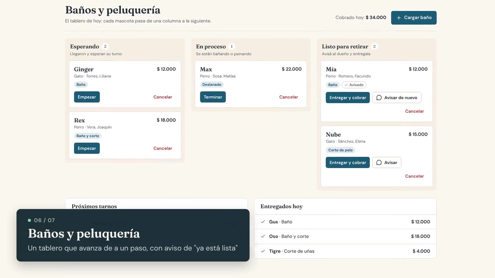

# Veterinaria

Sistema de gestión para veterinarias: mascotas y dueños, turnos, vacunas, venta de alimento, stock, internación y baños en una sola aplicación de escritorio. Funciona sin internet y los datos quedan en la computadora del local.



[Ver el video de la demo en mi portafolio](https://sergio-cardozo.vercel.app/#p-veterinaria)

## Qué hace

- Agenda y recepción: turnos por veterinario sin superposiciones, sala de espera, cobro de la consulta y recordatorio por WhatsApp.
- Ficha de cada mascota con su dueño, historia clínica, peso y temperatura.
- Carnet de vacunas: avisa quién tiene la dosis vencida y arma el mensaje de WhatsApp.
- Mostrador: venta de alimento por unidad o por kilo suelto, con forma de pago y anulación.
- Stock que baja solo con cada venta, con entradas, mermas, conteos y aviso de stock mínimo.
- Internación: notas de evolución con temperatura y alta con cobro de los días.
- Baños y peluquería: tablero con Esperando, En proceso y Listo para retirar, con aviso por WhatsApp.
- Reportes de atenciones, ausentismo, ventas con ganancia, internación y baños, exportables a Excel.
- Usuarios con PIN y roles de administración, recepción y veterinario.

## Aspectos técnicos

- **Nada queda desactualizado:** el stock y los totales se calculan a partir de los movimientos, no se guardan como números sueltos.
- **Cada cobro con su origen:** cada cobro queda registrado junto con el cambio de estado que lo origina, como el alta de una internación o la entrega de un baño.
- **Datos en el local:** SQLite con Drizzle, validación con Zod y copias de seguridad que se restauran desde el mismo sistema.

## Tecnologías

Electron · React · TypeScript · Tailwind CSS · TanStack Query · Zod · SQLite con Drizzle · Vitest

## Cómo ejecutarlo

Necesitás [Node.js](https://nodejs.org) en su versión LTS.

```bash
npm install
npm start          # abre la aplicación en modo desarrollo
npm test           # corre las pruebas automatizadas
npm run typecheck  # revisa los tipos de TypeScript
npm run make       # genera el instalador (en Windows, el .exe)
```

La primera vez que se abre, el sistema pide crear el primer usuario con su PIN. Un administrador puede cargar datos de ejemplo para probarlo.

## Estructura

```
src/
  main/        proceso principal de Electron: base de datos, servicios y canales IPC
  preload/     puente seguro entre la ventana y el proceso principal
  renderer/    interfaz en React
  compartido/  tipos, esquemas de Zod y cálculos que usan los dos lados
pruebas/       pruebas automatizadas con Vitest
```

## Autor

**Sergio Cardozo**, desarrollador full stack en Formosa, Argentina.
[Portafolio](https://sergio-cardozo.vercel.app) · [LinkedIn](https://www.linkedin.com/in/sergiocardozo-dev) · [GitHub](https://github.com/Gabicrdz)
